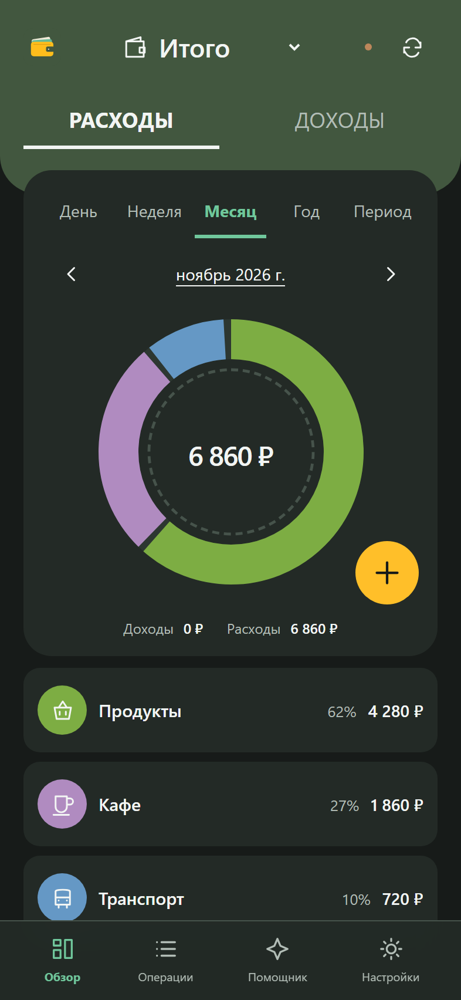

# SimpleAgentFinanceAPP (SAFA)

[Русский](README.md)

A personal and shared finance application with Russian and English interfaces. It can be
installed as a PWA and used to record transactions offline.



- Income, expenses, accounts, categories, search and period summaries.
- Twelve currencies: RUB, USD, EUR, CNY, GBP, CHF, GEL, TRY, AED, KZT, BYN and UAH.
  Totals stay separate; enter both amounts for transfers between currencies.
- Shared books, synchronization and a local queue of changes.
- XLSX import and export and local JSON backups.
- Optional assistant and MCP integration for external agents.

There are no automatic exchange rates, converted grand totals or bank connections.

## Start

Install Docker and Docker Compose. Copy [.env.example](.env.example) to `.env` and
set separate random values for `APP_SECRET` (at least 32 characters),
`POSTGRES_PASSWORD` and `REGISTRATION_PASSWORD`. Hex strings generated with
`openssl rand -hex 32` work well. Then run:

```sh
docker compose up -d --build
```

Open <http://localhost:18080>. Trusted HTTPS is required for phone installation
and external access; see [DEPLOYMENT.en.md](DEPLOYMENT.en.md) for configuration
and updates. The shared password permits registration; it does not grant access
to other users' books.

## Use and data

Install from the browser menu: on iPhone, Safari → Share → Add to Home Screen;
on Android, Chrome menu → Install app. Wait until offline access is ready.
Synchronization runs while the app is open. A server backup does not include
changes still on a phone: synchronize them or download a local JSON backup. XLSX
requires a running server. XLSX sheet names and headers remain in Russian for
compatibility. Choose the interface language in Settings; existing names and
records are not translated.

For a shared book, save your personal recovery key and invite another member
with a one-time code in Settings. Do not share the recovery key.

The optional assistant requires an OpenRouter key and sends requests and
attachments to an external provider. Review its suggestions before saving.

## Documentation

- [Deployment and backups](DEPLOYMENT.en.md)
- [Development and tests](DEVELOPMENT.en.md)
- [Restoring a Hestia backup](deploy/RESTORE.md)

License: [MIT](LICENSE).
