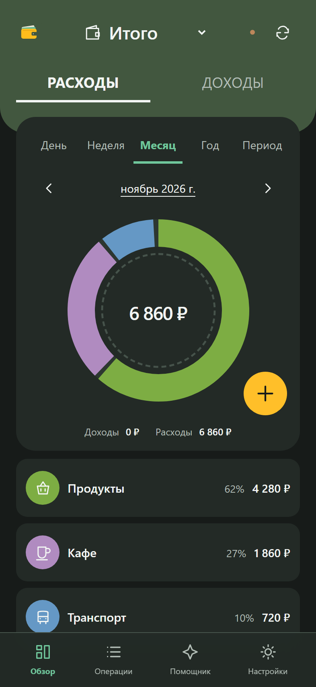

# SimpleAgentFinanceAPP (SAFA)

[English](README.en.md)

Приложение для личного и совместного учёта финансов. Интерфейс на русском языке;
его можно установить как PWA и вести локальные записи без сети.



- Доходы, расходы, счета, категории, поиск и итоги за период.
- 12 валют: RUB, USD, EUR, CNY, GBP, CHF, GEL, TRY, AED, KZT, BYN и UAH.
  Итоги раздельные; при переводе между валютами обе суммы вводятся вручную.
- Общая книга, синхронизация и локальная очередь изменений.
- Импорт и экспорт XLSX, локальная резервная копия JSON.
- Необязательный помощник и MCP для внешних агентов.

Автоматических курсов, конвертации общего итога и подключения к банкам нет.

## Запуск

Нужны Docker и Docker Compose. Скопируйте [.env.example](.env.example) в `.env`
и задайте отдельные случайные значения `APP_SECRET` (не менее 32 символов),
`POSTGRES_PASSWORD` и `REGISTRATION_PASSWORD`. Удобно использовать hex-строки,
например, полученные через `openssl rand -hex 32`. Затем:

```sh
docker compose up -d --build
```

Откройте <http://localhost:18080>. Для установки на телефон и доступа извне
нужен доверенный HTTPS; настройки и обновления описаны в [DEPLOYMENT.md](DEPLOYMENT.md).
Общий пароль разрешает регистрацию, но не открывает чужие книги.

## Использование и данные

Установите приложение через меню браузера: на iPhone — Safari → «Поделиться» →
«На экран Домой», на Android — меню Chrome → «Установить приложение». Дождитесь
отметки об офлайн-доступности. Синхронизация работает, пока приложение открыто.
Серверная копия не включает изменения, оставшиеся только на телефоне: синхронизируйте
их или скачайте локальную JSON-копию. XLSX требует работающего сервера.

Для совместной книги сохраните личный ключ восстановления, затем пригласите участника
одноразовым кодом в настройках. Не передавайте ключ другим людям.

Помощник работает только при настроенном ключе OpenRouter и передаёт запросы и
вложения внешнему провайдеру. Проверяйте предложения перед сохранением.

## Документация

- [Развёртывание и резервные копии](DEPLOYMENT.md)
- [Разработка и проверки](DEVELOPMENT.md)
- [Восстановление из копии Hestia](deploy/RESTORE.md)

Лицензия: [MIT](LICENSE).
